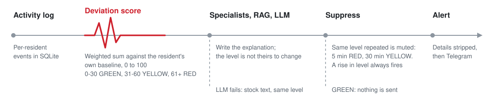

<div align="center">

# CareWatch

**Multi-agent monitoring for elderly care** — scores each resident's day against their own routine, explains deviations to family with retrieval-augmented LLM text, and sends Telegram alerts (optional voice reminder) with personal details stripped.

<picture>
  <source media="(prefers-color-scheme: dark)" srcset="docs/how-it-works-dark.svg">
  
</picture>

<sub>Pipeline as wired in <code>src/graph.py</code>: the risk level comes from the score, never from the LLM.</sub>

</div>

---

## Why

Families of older people living alone find out about a missed dose or a fall late. CareWatch compares today's logged activity with that resident's own 7-day baseline, so someone who always takes pills at 9pm is not flagged for missing 8am. The alert level is a plain weighted score a clinician can read and adjust; the LLM only writes the message that goes with it.

Monitoring dashboard: https://carewatch-blue.vercel.app/dashboard.html

---

## Status

The numbers further down were reported by earlier eval runs. They do not reproduce at the current HEAD. `DeviationDetector.check()` passes `_today=` to `ActivityLogger.get_today()` (`src/deviation_detector.py:91`), which does not accept it (`src/logger.py:62`). In an offline run (`python -m eval.eval_agent --no-llm`, Python 3.11, no API keys) 14 of 20 scenarios return an error, giving F1 0.857 and FNR 0.250 for all three agents. In `tests/test_merge_integration.py`, TC21, TC22, TC23 and TC26 fail for the same reason and the other four pass. This needs a code fix; the README does not paper over it.

---

## Architecture

The graph has 11 nodes and runs in a fixed order (`src/graph.py`):

1. `scan_node` — entry point. Returns immediately unless `image_bytes` is given; otherwise reads a pill-bottle label and records a medication event.
2. `detect_node` — `DeviationDetector` computes the weighted score and level; the CUSUM drift monitor runs after it and a CUSUM failure is non-fatal.
3. `route_node` — picks specialists from the anomalies (`route()` in `src/specialist_agents.py`).
4. `fall_node`, `med_node`, `med_scan_node`, `chronic_node`, `routine_node` — run one after another, not in parallel. Each returns at once if it was not routed. `ChronicAgent` is added whenever `MedAgent` or `MedScanAgent` is. Each specialist retrieves context with `get_context_v2()` and calls the LLM, with a fallback text on failure.
5. `summary_node` — `SummaryAgent` merges specialist outputs by concern level and agent priority. Risk score and level are copied from the detector.
6. RED goes through `human_gate_node`, which only sets `human_approved = True` and does not wait for anyone; other levels skip it.
7. `alert_node` — `AlertSuppressionLayer.send()`, then the audit write to `agent_runs`.

Three agent implementations share the same `run()` interface and are benchmarked on the same scenarios:

| Agent | Architecture | Role |
|-------|-------------|------|
| `CareWatchAgent` | Custom linear pipeline | Baseline; uses `get_context()` |
| `CareWatchOrchestrator` | LangGraph multi-agent | The graph above |
| `CareWatchLangChainAgent` | LangChain tool-calling | Eval comparison |

---

## Added later

| Capability | Implementation | Entry point |
|---|---|---|
| Medication label scanner | `src/label_detector.py` — returns random mock prescriptions; swap `extract_from_image()` for a vision API | `scan_node` in graph |
| Chronic illness inference | `src/chronic_detector.py` — local KB, then Groq/SEA-LION fallback | `ChronicAgent` co-fires with `MedAgent` |
| TTS reminders | `src/tts.py` — pyttsx3 | `voice_alert=True` on `graph.invoke()` |
| PDPA privacy layer | `src/privacy.py` — pseudonymous IDs, PII stripping, consent log, retention | `strip_pii()` before every Telegram send |

The graph grew from 8 nodes to 11. `scan_node` is the entry point and is a no-op when `image_bytes` is absent.

---

## Evaluation Results

Reported by earlier runs; see Status above for what happens at HEAD.

### Agent Comparison (20 deterministic scenarios, `--no-llm` mode)

| Agent | F1 | FNR | LLM Alignment | p50 | p95 | Tokens/run |
|-------|----|-----|---------------|-----|-----|------------|
| Custom (Phase 1) | 1.000 | 0.000 | 95% | 1ms | 2ms | TBD |
| LangGraph multi-agent | 1.000 | 0.000 | 95% | 454ms | 2424ms | TBD |
| LangChain | 1.000 | 0.000 | 95% | 1ms | 9ms | TBD |

These were not reproduced. The machine and date of the original run were not recorded. In `--no-llm` mode no LLM runs, so the LLM Alignment column cannot come from that mode.

Positive class for F1 and FNR is expected level RED (`eval/eval_agent.py`). FNR is the share of expected-RED scenarios the system did not call RED.

The LangGraph p95 gap against the custom agent was attributed to graph setup and MemorySaver across 11 nodes, not to LLM latency. That was not re-measured. A possible fix is an early-exit edge from `detect_node` to `alert_node` on GREEN; the graph has no such edge today.

### Integration Test Suite (8 scenarios, pytest)

| Test | What it checks | At HEAD |
|---|---|---|
| TC21 — scan_node no-op | `image_bytes=None` produces no scan_result | fails |
| TC22 — scan_node processes image | `image_bytes` gives `scan_result` with medication_name, confidence, meal_relation | fails |
| TC23 — scan writes DB | `medication_event` row written for scanned medication | fails |
| TC24 — ChronicAgent T2DM | 10 Metformin events give "Type 2 Diabetes" in family alert summary | passes |
| TC25 — insufficient history | 1 event gives "Insufficient history" without error | passes |
| TC26 — low-confidence scan | confidence < 0.75 gives `concern_level=watch`, manual verification requested | fails |
| TC27 — PII stripped | Real names never appear in Telegram payload | passes |
| TC28 — TTS fires | `voice_alert=True` calls `speak()` once on YELLOW/RED | passes |
```bash
python -m pytest tests/test_merge_integration.py -v
```

### Pipeline Metrics (Phase 2, with LLM)

Reported by an earlier run with a Groq key; not reproducible without one.

| Metric | Score |
|--------|-------|
| Pipeline F1 | 1.000 |
| Pipeline FNR | 0.000 |
| LLM Alignment | 95% |
| p50 latency | 229ms |
| p95 latency | 431ms |
| RAG Precision@1 | 0.920 |
| RAG MRR | 0.960 |

### Prompt Variant Comparison

| Variant | Style | Alignment | FNR | p50 |
|---------|-------|-----------|-----|-----|
| A1C1 | Decision table + self-check (baseline) | 95% | 0.000 | 229ms |
| A2C1 | Chain-of-thought + self-check | 100% | 0.000 | 232ms |
| A1C3 | Decision table + no self-check | 100% | 0.000 | 214ms |

Not reproduced. The separate self-check call was reported to add about 5 seconds with no measurable safety benefit at `temperature=0.3`. A1C1 is still the default variant (`src/prompt_registry.py:9`, `:41-46`), so the separate self-check still runs unless another variant is passed.

### RAG Retrieval (25 ground-truth queries)

The raw ChromaDB numbers are in `eval/results/rag_eval_20260316_103151.json`: MRR 0.960, Precision@1 0.92, zero-hit queries 0, over 25 queries. That file also lists Recall@2 and Recall@3 as 1.08, which cannot be right for a recall; the metric is miscounted. The hybrid MRR of 0.933 is not in any committed result file.

| Metric | Raw (ChromaDB only) | Hybrid (BM25 + dense RRF) |
|--------|--------------------|-----------------------------|
| MRR | 0.960 | 0.933 |
| Precision@1 | 0.920 | not reported |
| Zero-hit queries | 0 | 0 |

---

## RAG 2.0 — What Was Built and Why

Standard RAG: `embed → store → single query → top-k docs → LLM`.

The problem: a resident with a fall and a missed medication produces the query `"fallen FALLEN pill_taking MISSING"`, which is semantically diluted and retrieves neither topic well.

Phase 4 changed this to:
```
anomalies → _decompose_queries()     → ["fall detection emergency response...",
                                         "missed medication dosing window..."]
         → _hybrid_retrieve() × N   → BM25 + ChromaDB cosine → RRF merge (k=60)
         → _rerank()                 → cross-encoder stub (upgrade path documented)
         → deduplicated context      → LLM
```

Each anomaly type maps to a domain-specific query. Two anomaly types give two independent retrievals merged with RRF. The specialist agents in the LangGraph path call this (`src/specialist_agents.py:82`); the custom agent still calls `get_context()`. Swapping in a real cross-encoder is a change to the `_rerank()` body.

---
## Quick Start
```bash
git clone https://github.com/cmengu/carewatch-backend
cd carewatch-backend
cp .env.example .env          # add GROQ_API_KEY, CAREWATCH_BOT_TOKEN, CAREWATCH_CHAT_ID
python generate_mock_data.py   # populate DB before first run
docker-compose up              # starts pipeline + telegram listener
```

Or without Docker:
```bash
pip install -r requirements.txt
python run_pipeline.py --find-red                    # custom agent (default)
python run_pipeline.py --find-red --agent langgraph  # LangGraph orchestrator
python run_pipeline.py --find-red --agent langchain  # LangChain baseline
```

Run eval:
```bash
python -m eval.eval_agent --no-llm                 # deterministic pipeline metrics, no API cost
python -m eval.eval_agent                          # full run including LLM alignment scoring
python -m eval.eval_retrieval --mode both          # RAG before/after comparison
python -m pytest tests/test_merge_integration.py -v  # merge integration suite
```

Scan a medication label via API:
```bash
python app/api.py &
curl -X POST http://localhost:8000/residents/resident_001/scan \
  -F "file=@label_recognition/image1.png"
# Returns a random mock prescription, e.g. {"medication_name": "Metformin", "dose": "500mg", ...}; the scanner is not real vision yet
```

---

## Design Decisions

**1. Weight-based risk scoring over ML classifier.**
A weighted sum (pill missing = 40pts, meal missing = 25pts, timing deviation = up to 25.5pts) was chosen because no labelled training data exists for this resident population. Every risk score is fully traceable to a specific anomaly — a clinician can adjust weights without retraining.

**2. CUSUM for drift detection over rolling z-score.**
CUSUM accumulates small deviations before alerting, catching gradual decline (a resident eating less over 10 days) that a rolling z-score would miss until the deviation became large. Tradeoff: CUSUM state is in-memory and resets on process restart. Fix: persist accumulators to SQLite.

**3. Hybrid RAG (dense + sparse) over embedding-only retrieval.**
ChromaDB cosine similarity retrieves semantically related documents but misses exact clinical token matches (e.g. drug names). BM25 keyword search covers the exact-match case. RRF merges both ranked lists without requiring a common score scale. At the current corpus size dense scored higher; the claim that hybrid wins at 10k+ facts has not been tested.

**4. Self-check variants.**
An earlier eval reported the second Groq call adding ~5 seconds with no measurable benefit at `temperature=0.3`, so variants without it exist (A1C2, A1C3). The default, A1C1, still uses the separate call.

**5. AlertSuppressionLayer to prevent alert fatigue.**
A repeat of the same level is suppressed for 5 minutes (RED) or 30 minutes (YELLOW), and a rise in level always fires (`src/suppression.py:17-22`). Alert fatigue causes families to ignore notifications — defeating the system's purpose. Tradeoff: a new anomaly of the same level within the window, for a different reason, is muted.

**6. Personalised baselines per resident over population norms.**
A resident who always takes pills at 9pm generates false positives under a population norm expecting 8am. Per-resident baselines built from the last 7 days of logs (`src/baseline_builder.py:54`) calibrate detection to individual routines.

**7. Groq (llama-3.3-70b-versatile) over GPT-4o.**
Reported p50 of 229ms (see Pipeline Metrics); the ~800ms GPT-4o figure was not measured in this repo. The concern-level classification task does not require GPT-4o's reasoning depth — a well-structured chain-of-thought prompt achieves 100% alignment on llama-3.3-70b. Tradeoff: Groq free tier has a 100k token/day limit.

**8. scan_node as graph entry point, no-op when image absent.**
Making scan_node the entry point rather than a conditional branch means the graph structure is identical for all runs. When `image_bytes` is None, scan_node returns immediately and the pipeline is identical to pre-merge behaviour. A separate scan graph was rejected because it would duplicate the suppression and alert logic.

**9. ChronicAgent co-fires with MedAgent rather than opt-in routing.**
Medication history is always relevant when medication anomalies are detected. Opt-in routing would require callers to explicitly request chronic inference — easy to forget. ChronicAgent fires automatically whenever MedAgent fires and degrades gracefully when history is insufficient (< 2 events).

**10. PII stripped at alert boundary, not at storage.**
PDPA requires that personal data is protected in transmission, not necessarily at rest within a closed system. Stripping PII in `alert_system.py` before the Telegram send keeps the internal audit log queryable by person_id while ensuring no real names leave the system boundary. Consent is logged server-side (SQLite) rather than frontend-only because PDPA requires an auditable record.

---

## Graceful Degradation

| Dependency | Failure mode | System behaviour | Impact |
|------------|-------------|------------------|--------|
| Groq API | `_fallback()` fires | `concern_level` derived from `risk_level` | Degraded explanation, alert still fires |
| ChromaDB | `_available = False` | `rag_context = ""` | Lower quality explanation, alert still fires |
| SQLite lock | WAL mode + 30s timeout | Retry without blocking readers | None under normal load |
| Telegram API | Exception caught, logged | Alert logged to DB, not delivered | Delayed delivery |
| Vision API (scan) | `extract_from_image()` raises | `scan_result = None`, pipeline continues | Scan feature unavailable, detection unaffected |
| TTS engine | Exception caught, logged | Alert fires via Telegram only | No voice reminder |
| ChronicAgent DB read | Exception caught, `events = []` | "Insufficient history" returned | No chronic inference for this run |

**Known gap:** Telegram retry queue not implemented. Fix: `alert_send_queue` table with `retry_count` and `next_retry_at`, polled every 30s.

---

## Known Limitations

**CUSUM state resets on restart.** Trend detection is in-memory. A gradual decline being tracked is lost on process restart. Fix: persist CUSUM accumulators to SQLite on each check.

**Human-gate deferred.** `human_gate_node` sets a flag and does not pause the graph. `CareWatchOrchestrator.resume()` raises `NotImplementedError`. The LangGraph interrupt architecture is wired — re-enabling requires adding a `thread_id` column to `alert_store` and updating the Telegram listener to call `resume()` on `/clear`.

**Telegram send failures are not retried.** A failed delivery is logged but not queued. Fix: `alert_send_queue` table polled by a background thread every 30 seconds.

**Label scanner returns mock data.** `MedicationLabelDetector.extract_from_image()` returns a random realistic prescription. Production path: swap the function body to call Gemini Vision or GPT-4o. The interface is unchanged.

**ChronicAgent LLM fallback requires API key.** When a medication is not in the local knowledge base, `ChronicDetector.infer_from_name()` falls back to Groq then SEA-LION. `SEA_LION_API_KEY` is not yet in `.env.example`.

**Hybrid retrieval scored lower than raw.** A reported hybrid MRR of 0.933 against 0.960 raw suggests BM25 adds noise at this corpus size, yet the specialist agents already use `get_context_v2()`. The `_rerank()` step is still a stub.

---

## Project Structure
```
src/
  agent.py              # CareWatchAgent — custom single-agent pipeline
  orchestrator.py       # CareWatchOrchestrator — LangGraph multi-agent
  graph.py              # LangGraph StateGraph, 11 nodes, AgentState TypedDict
  specialist_agents.py  # FallAgent, MedAgent, RoutineAgent, ChronicAgent, MedScanAgent, SummaryAgent
  label_detector.py     # CV medication label scanner (mock → swap for vision API)
  chronic_detector.py   # Chronic illness inference from medication history
  privacy.py            # PDPA: pseudonymous IDs, PII stripping, consent log, retention
  tts.py                # TTS reminder delivery (pyttsx3)
  medication.py         # MedicationRepo — schedules, events, reminders
  medication_ai.py      # MedicationAI — illness inference helpers
  langchain_agent.py    # LangChain comparison agent (eval only)
  deviation_detector.py # Personalised baseline deviation detection
  cusum_monitor.py      # CUSUM gradual drift detection
  rag_retriever.py      # ChromaDB + BM25 hybrid RAG, query decomposition, RRF
  llm_explainer.py      # Groq LLM explanation + prompt variants
  suppression.py        # Alert suppression layer (4hr window)
  alert_system.py       # Telegram delivery + TTS trigger + PII stripping
  models.py             # AgentResult, RiskResult, AnomalyItem, SpecialistResult
  prompt_registry.py    # Versioned prompt loader with caching

app/
  api.py                # FastAPI — pipeline trigger, scan upload, medication CRUD, consent
  realtime_inference.py # Background monitoring loop + meal reminder loop

eval/
  scenarios.py          # 20 deterministic eval scenarios
  eval_agent.py         # Three-way agent comparison benchmark
  eval_retrieval.py     # RAG precision/recall/MRR — supports --mode raw|hybrid|both
  eval_prompts.py       # Prompt variant A/B testing

tests/
  test_merge_integration.py  # 8 pytest integration tests (TC21–28) — graph.invoke with isolated DB

data/
  prompts/              # Versioned prompt files (A1C1 through A3C1)
  chroma_db/            # ChromaDB vector store (47 clinical knowledge facts)
  carewatch.db          # SQLite — activity_log, baselines, alerts, agent_runs, medication_event
  medications_db.json   # Local chronic illness knowledge base (auto-extended by LLM fallback)

label_recognition/      # Sample pill bottle images for scan testing
model/                  # Trained CV model files (MobileNet, YOLO weights)
scripts/
  infer_chronic_illness.py        # Standalone CLI: infer conditions from medication name
  infer_image.py                  # Standalone CLI: scan pill bottle image
  prescription_to_illness_pipeline.py  # End-to-end prescription → illness report
```
